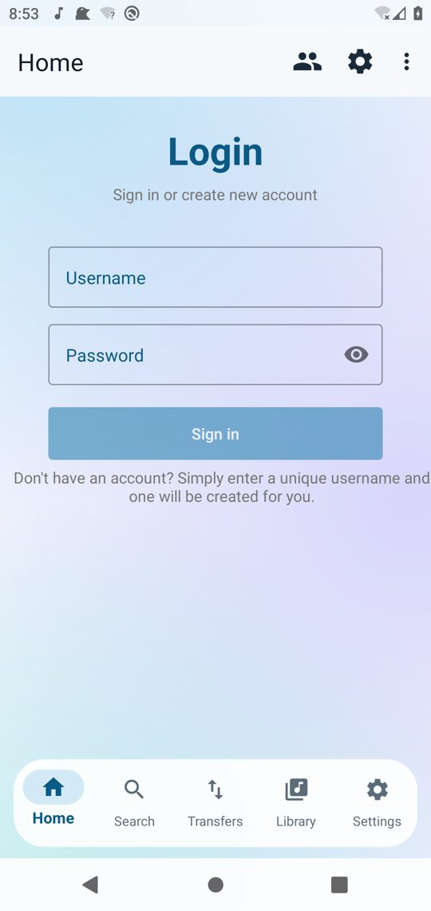
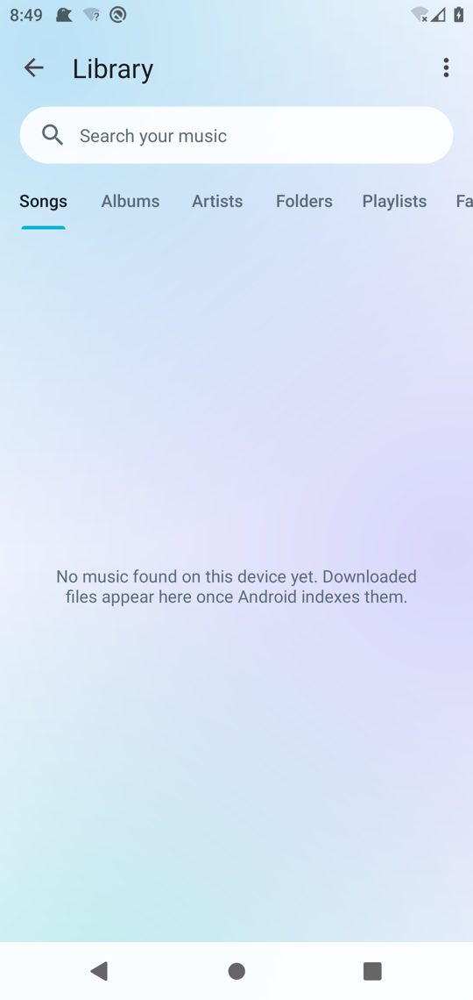
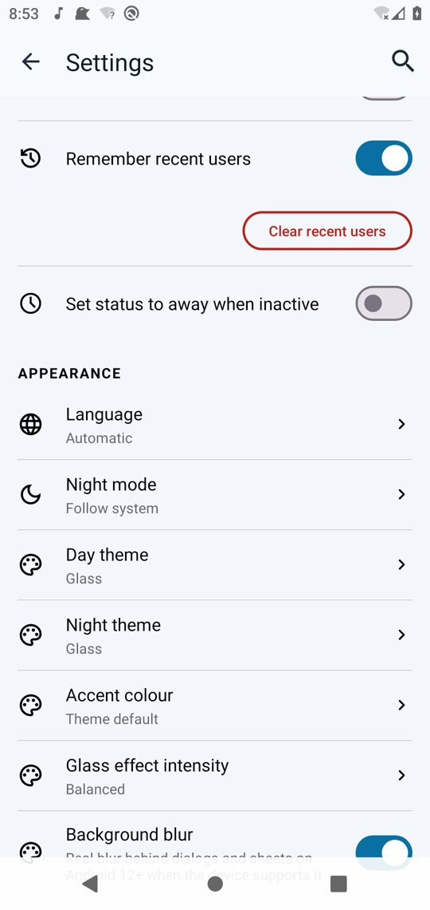

<h2><b>SeekerOG</b></h2>
<h4>Seeker with advanced search, a Glass interface, a music library and an integrated player.</h4>

  

**SeekerOG** (`com.eibyx.seekerog`) is a fork of [Seeker](https://github.com/jackBonadies/SeekerAndroid) that keeps the official Soulseek network, accounts and the Soulseek.NET engine, and adds:

- Nicotine+-style **advanced search syntax** and graphical filters (format, bitrate, sample rate, bit depth, size, duration, availability, regex, phrases…), filter profiles, favourite searches, duplicate hiding, CSV export
- **Glass** light / dark / AMOLED themes, floating bottom bar (Home · Search · Transfers · Library · Settings), new Home dashboard, appearance settings
- **Library and player** (MediaStore library, background playback, media controls, equalizer, quality info)
- Password stored encrypted with the Android Keystore; FOSS flavour without telemetry

See [docs/SEEKEROG.md](docs/SEEKEROG.md) for the feature list, search syntax, build and release signing instructions. Releases: <https://github.com/Eibyx/SeekerOG/releases>.

---

*Original Seeker README follows.*

<h2><b>Seeker</b></h2>
<h4>A Soulseek client for Android.</h4>

Seeker is a [Soulseek](https://en.wikipedia.org/wiki/Soulseek) client for Android written in C# supporting downloading, searching (including wishlist and filters), sharing, messages, chatrooms, port forwarding, user info, privileges, and more.

This work uses a modified version of the [Soulseek.NET](https://github.com/jpdillingham/Soulseek.NET) library for communicating with Soulseek server and network peers.  It also references the unofficial [Soulseek Protocol Documentation](https://nicotine-plus.github.io/nicotine-plus/doc/SLSKPROTOCOL.html) implemented by the developers of the [Nicotine+](https://github.com/nicotine-plus/nicotine-plus) client.

- The Soulseek server, which makes this app possible, relies on donations. Donate: [here](https://www.slsknet.org/donate.php)

- Please help translate: [here](https://crowdin.com/project/seeker)

- Official release is through Google Play store: [here](https://play.google.com/store/apps/details?id=com.companyname.andriodapp1&hl=en_US&gl=US)

This app will always be completely free and open source software, no ads, no 'premium' versions or paid features, etc.

---

## Screenshots

---

## License

Seeker is licensed under the [GNU General Public License v3.0 only](LICENSE) (`GPL-3.0-only`), with Additional Terms pursuant to Section 7 of the GPLv3.
