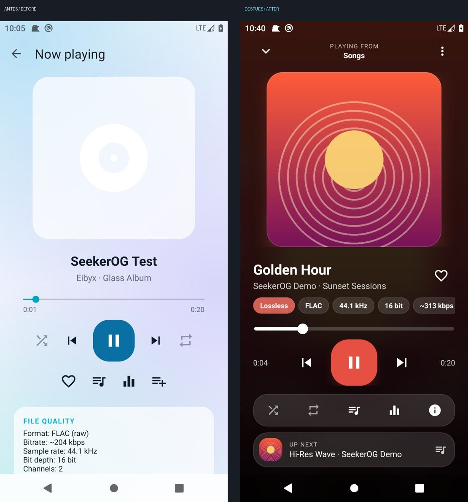
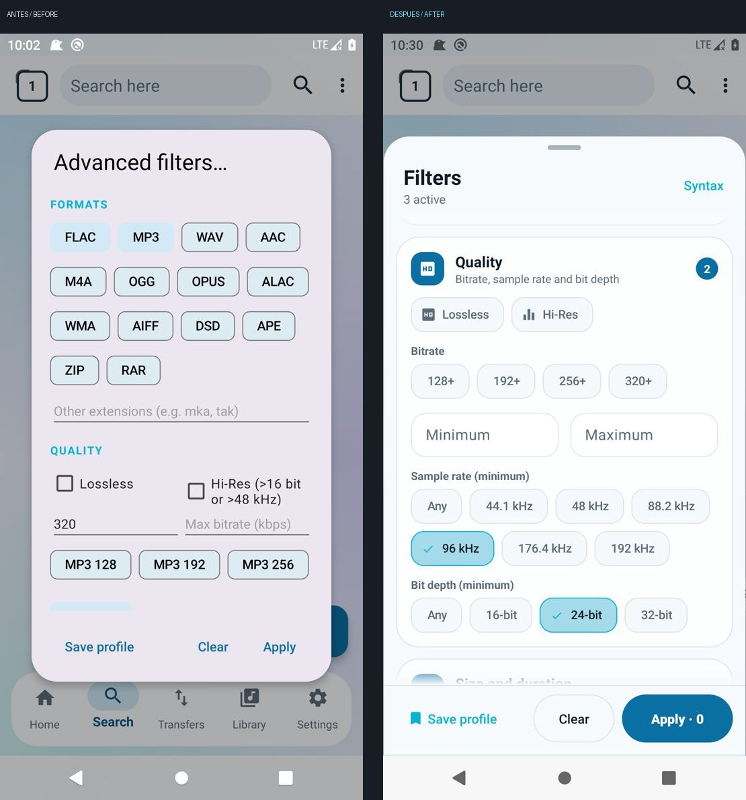
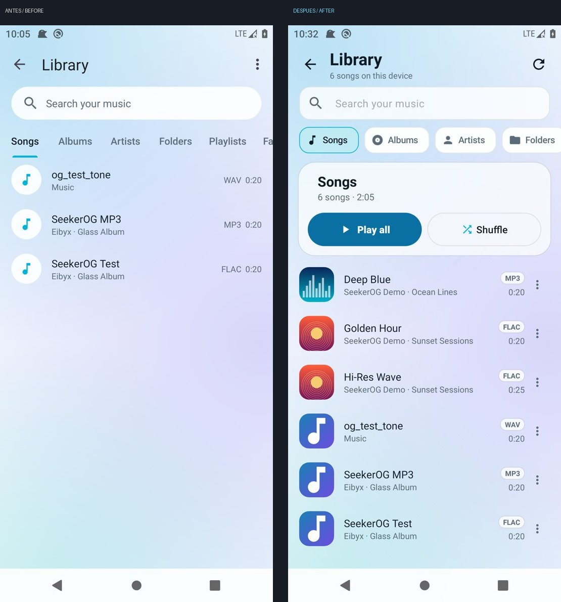
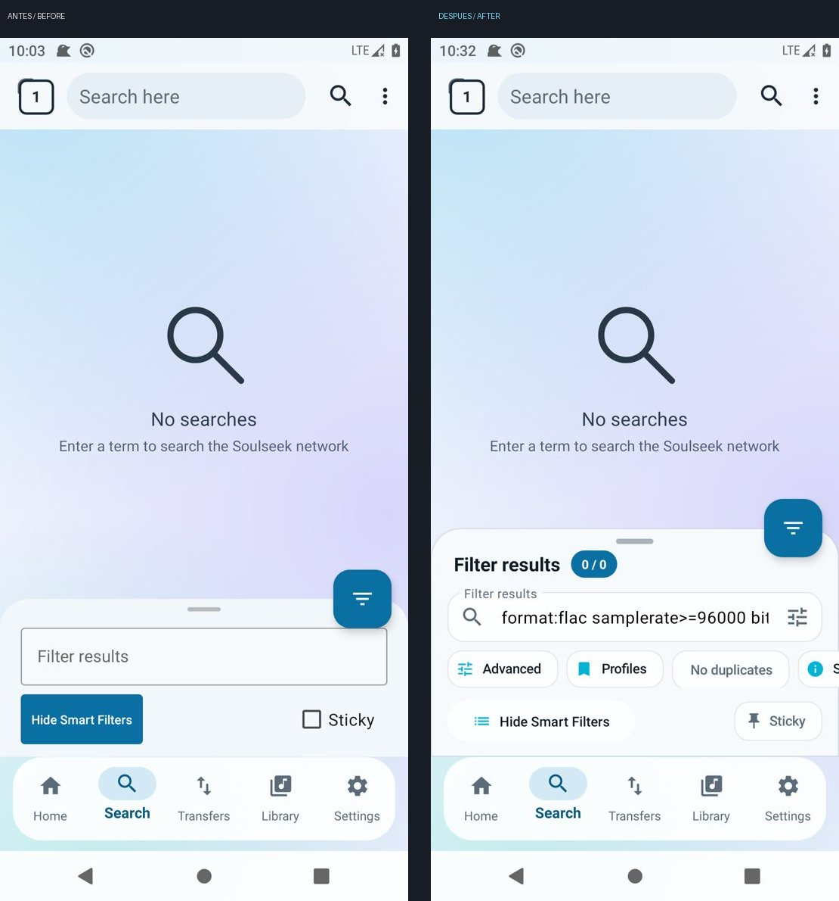

# Rediseño: reproductor, biblioteca y filtros (inspirado en Namida)

Rama `feature/namida-player-and-filters-redesign`. Capturas reales (emulador Android 10, x86_64) en `docs/screenshots/redesign/` (`compare_*.jpg` = antes / después).

| | |
|---|---|
|  |  |
|  |  |

## Namida: qué se tomó y cómo

Namida (namidaco/namida) se publica bajo un **EULA propietario**: prohíbe usar partes del código para fines distintos al aprendizaje personal o contribuir a Namida. Además es Flutter/Dart y SeekerOG es C#/.NET Android. Por eso **no se copió código, iconos ni assets**: solo se estudió la UX y se reimplementó desde cero.

Conceptos adaptados:
- Colores dinámicos derivados de la carátula (fondo, botón de reproducción, acentos).
- Fila de transporte `posición · anterior · reproducir · siguiente · duración`; botón de reproducción grande con brillo teñido del color de la carátula y respuesta al pulsar (escala).
- Carátula protagonista con fundido al cargar; la carátula "respira" (se reduce al pausar), deslizar para cambiar de pista, tocar para pausar.
- Cola con miniaturas, pista actual resaltada, arrastrar para reordenar, deslizar para quitar.
- Información de calidad como insignias / paneles ("audio path") en vez de texto plano.

No implementado de Namida (por coste o datos no disponibles): forma de onda real (requiere decodificar el audio completo; una forma de onda falsa sería inventar datos), partículas / "party mode", letras.

## Reproductor

- **Now Playing** (`Seeker/Player/PlayerActivity.cs`, `seekerog_player.xml`): fondo con la carátula difuminada (miniatura reescalada en Android 6+, `RenderEffect` real en Android 12+ si el desenfoque está activado) + tinte del color profundo de la carátula; cabecera "Reproduciendo desde"; carátula cuadrada adaptativa con esquinas de 28 dp y sombra teñida (Android 9+); título con marquesina, artista · álbum, favorito; píldoras de calidad (Hi-Res / Sin pérdida, formato, kHz, bits, kbps, canales); seekbar gruesa redondeada; transporte estilo Namida; acciones secundarias en una píldora glass con punto de "activo" (aleatorio, repetir/repetir una, cola, ecualizador, info); tarjeta "A continuación"; menú "más". Transiciones de entrada/salida deslizantes. Siempre contenido claro sobre la carátula (coherente en claro / oscuro / AMOLED).
- **Paleta** (`ArtPalette.cs`): histograma de tono ponderado por saturación sobre una copia de 24×24 px, en segundo plano (< 1 ms). Sin bibliotecas nuevas.
- **Mini player** (`MiniPlayerController.cs`, `seekerog_mini_player.xml`): tarjeta glass redondeada con miniatura, título/artista, play/pause con acento, siguiente y barra de progreso fina; aparece con animación. Se usa en la pantalla principal (encima de la barra flotante) y en la Biblioteca.
- **Cola** (`QueueSheet.cs`): hoja glass con miniaturas, duración total, botón aleatorio, arrastrar el asa para reordenar, deslizar para quitar, tocar para saltar. El servicio ganó `MoveQueueItem`, `RemoveFromQueue`, `PlayNext`, `UpNext`, `QueueSource` (la reproducción en curso nunca se interrumpe al reordenar).
- **Información de audio** (`AudioInfoSheet.cs`): insignias, cuadrícula de 2 columnas (códec, bitrate, frecuencia, profundidad, canales, duración, tamaño, contenedor), salida de audio y acceso al ecualizador. Datos reales vía `ArtworkLoader.Probe` (estructurado); lo desconocido se indica como tal.
- Sin cambios funcionales en: servicio en primer plano, MediaSession, notificación, Bluetooth/auriculares, foco de audio, ecualizador, favoritos, listas.

## Biblioteca

`LibraryActivity.cs`: pestañas como chips con icono, buscador redondeado, cabecera de detalle (álbum / artista / carpeta / lista / favoritos / descargas) con carátula y botones **Reproducir** / **Aleatorio**, álbumes en cuadrícula de 2 columnas con carátula, artistas con avatar de inicial coloreado, filas con miniatura, insignia de formato, duración y menú (reproducir a continuación, añadir a cola / lista, favorito, información de audio), pista actual resaltada. Miniaturas con `ThumbnailLoader` (miniaturas de MediaStore en Android 10+, album-art / imagen incrustada antes; caché LRU de 120 entradas; máx. 2 decodificaciones simultáneas; descarta filas recicladas).

## Filtros

- **Filtros avanzados** (`AdvancedFilterDialog.cs`, `seekerog_advanced_filter.xml`): hoja glass a pantalla casi completa con cabecera (título, nº de filtros activos, Sintaxis), fila de perfiles guardados (un toque los carga), y secciones en tarjetas con icono, subtítulo y contador: Formatos (chips multiselección + extensiones propias), Calidad (Sin pérdida / Hi-Res, bitrate con presets 128+…320+ y mín./máx. en kbps, frecuencia y profundidad como chips de selección única en lugar de spinners), Tamaño y duración (campos con unidades), Disponibilidad (interruptor de plaza libre, cola, velocidad), Texto (excluir / obligatorio o sintaxis), y **Resumen** (chips legibles + sintaxis generada). Barra fija inferior: Guardar perfil (texto), Limpiar (contorno), **Aplicar · N** (primario, con el número de resultados que coinciden, calculado en segundo plano con debounce y cancelación).
- **Filtro rápido** en resultados (`searches.xml`): hoja glass con título y contador "visibles / total" (en acento al filtrar), campo redondeado con icono de búsqueda y botón de filtros avanzados, fila de chips (Avanzados, Perfiles, Sin duplicados, Sintaxis), "Smart filters" como botón tonal y "Fijar" como chip con chincheta; FAB cuadrado redondeado con el acento del tema.
- El resultado sigue siendo la misma sintaxis de texto: filtros escritos, gráficos y perfiles son intercambiables. Nada cambia en lo que se envía al servidor de Soulseek.

## Sistema de diseño

Nuevos estilos reutilizables en `values/styles.xml`: `SeekerOG.Chip`, `SeekerOG.Chip.Action`, `SeekerOG.Field`, `SeekerOG.Button.Primary/Secondary/Text/Tonal`, `SeekerOG.FilterSection`, `SeekerOG.BottomSheetDialog`, formas (`Shape.Chip/Field/Pill/Fab`); listas de color con estados (`color/og_chip_*`, `og_field_stroke`); atributos de tema `glassOutline` y `glassFieldColor` definidos para claro, oscuro, AMOLED y temas clásicos; `GlassSheet` (hojas glass con desenfoque real en Android 12+, *insets* de navegación).

## Rendimiento

Sin blur en listas; la carátula difuminada es un bitmap de 96 px; paleta y sondeo de calidad fuera del hilo de UI; miniaturas acotadas; recuento de coincidencias con debounce y cancelable; animaciones cortas y desactivables (Ajustes → Animaciones / Reducir efectos).

## Pruebas realizadas

- 647 pruebas unitarias superadas.
- Emulador Android 10 x86_64 (emulación por software, sin KVM): biblioteca, reproducción FLAC/MP3 con carátulas incrustadas, colores dinámicos, cola, info de audio, mini player en inicio y biblioteca, filtros avanzados (selección, contadores, resumen, aplicar), filtro rápido, temas claro / oscuro / AMOLED. Sin cierres de la app en logcat.

## Limitaciones pendientes

- No probado en dispositivo físico ni con resultados reales de Soulseek (el recuento "Aplicar · N" se vio con 0 resultados).
- Arrastrar para reordenar y deslizar para quitar en la cola no se pudieron ejercitar con gestos en el emulador (solo visualmente).
- Desenfoque real del fondo solo en Android 12+; en versiones anteriores se usa el reescalado.
- Las cadenas nuevas están en inglés y español.
